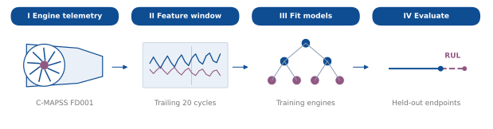
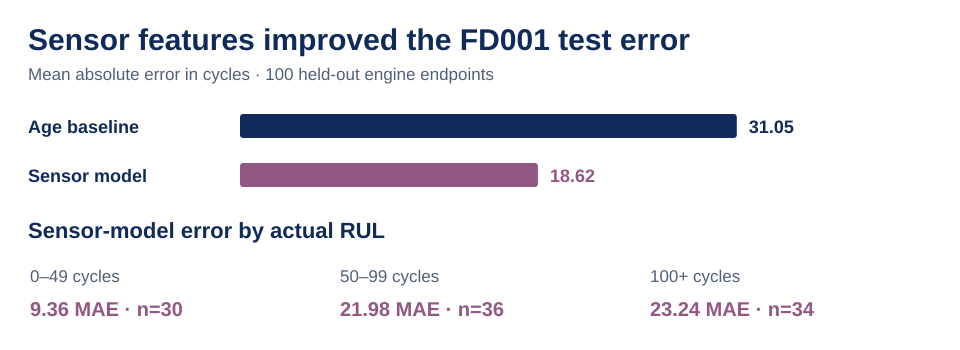

# Engine Remaining Useful Life from NASA C-MAPSS

Estimate how many operating cycles remain when a simulated turbofan is observed partway through its life. This project compares a simple engine-age baseline with a gradient-boosted model using sensor history.



## Results

On the 100 official FD001 test engines, mean absolute error fell from **31.05** to **18.62 cycles**. RMSE fell from **39.85** to **26.04 cycles**. Errors were smaller below 50 remaining cycles. The group sizes in the chart matter when interpreting the comparison.



[Metrics and archive hash](evidence/metrics.json) · [Per-engine predictions](evidence/predictions.csv)

## Method and limitations

Each training target is the number of cycles from the current row to the engine's observed end of life. Each feature window uses at most 20 readings from the current engine through the current cycle. The age baseline subtracts the current age from the median training lifetime. The sensor model adds operating settings, sensor values and trailing-window means and standard deviations.

The model fits the 100 official training engines and is evaluated once per engine at the final available cycle of the separate official test set. Test RUL labels are used only for evaluation. FD001 represents a single simulated operating condition and fault mode. This result should not be generalized to other subsets, real fleets or maintenance decisions.

## Reproduce

Python 3.11 or later:

```bash
python -m pip install -r requirements.txt
python evaluate.py
python figures.py
```

Use `python evaluate.py --zip /path/to/CMAPSSData.zip` for an offline run. The original archive is downloaded from NASA and remains outside Git. [NASA C-MAPSS source data](https://data.nasa.gov/dataset/cmapss-jet-engine-simulated-data)
